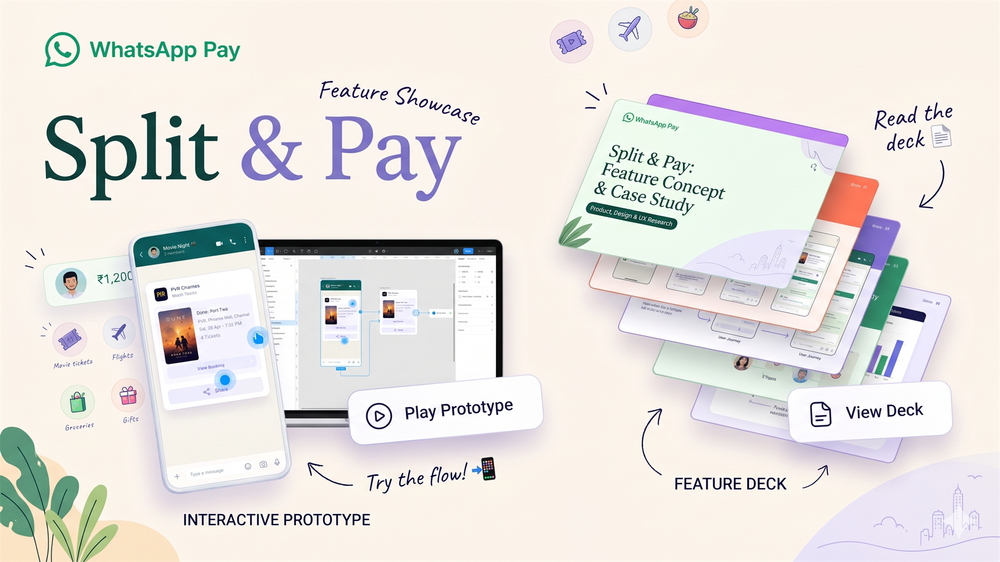
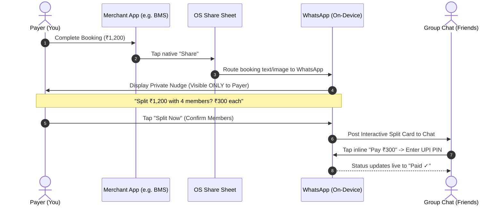
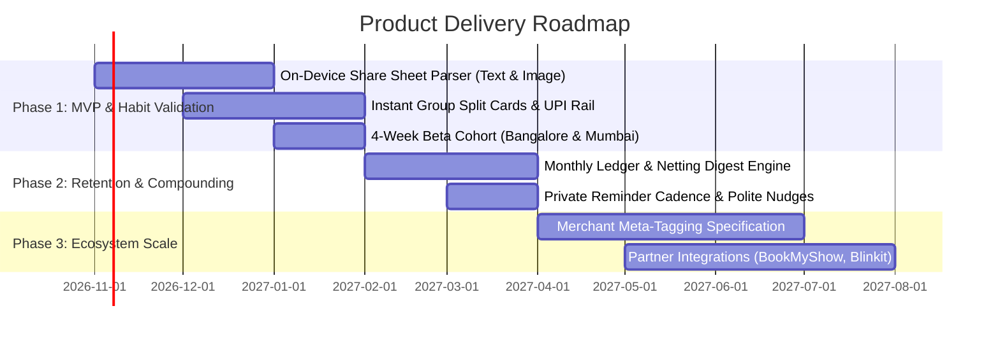

# WhatsApp Pay: Split & Pay 💸
### Product Thesis, Feature Strategy & Interactive Prototype

> **"WhatsApp doesn't need to win the merchant checkout counter. It can win what happens right after it."**

[](https://whatsapp-new-feature.vercel.app/)
[](https://github.com/pavitrapoojary/whatsapp-new-feature)
[](https://www.npci.org.in/)
[](https://pavitra-poojary.vercel.app/)

---

<div align="center">
  
  <p><em>Interactive 15-slide product thesis & live prototype: <strong><a href="https://whatsapp-new-feature.vercel.app/">whatsapp-new-feature.vercel.app</a></strong></em></p>
</div>

---

## 📌 Executive Summary

India processes **24+ Billion UPI transactions every month**, with over **37% (~7.6 Billion transactions)** representing peer-to-peer (P2P) transfers between friends, flatmates, and family. Yet, whenever a group books movie tickets on BookMyShow, orders groceries on Blinkit, or reserves a cab on Uber, the person who fronts the bill faces a broken, socially awkward, multi-app chase:

```mermaid
flowchart LR
    A["🛒 Book & Pay Merchant<br/>(BookMyShow / Blinkit)"] -->|"Capture Screenshot / Receipt"| B["💬 Share in WhatsApp<br/>'Booked! ₹1,200 total'"]
    B -->|"Manual Mental Maths"| C["📝 Log in Splitwise<br/>(Hit 3-4 daily entry cap)"]
    C -->|"Copy UPI ID / Amount"| D["💳 Open Google Pay / PhonePe<br/>(Complete Transfer)"]
    D -->|"Back to WhatsApp"| E["📱 'Bhej diya bro' + Screenshot<br/>(Lost in chat history)"]

    style A fill:#e9f1fb,stroke:#2b5d9b,stroke-width:1.5px
    B fill:#efeae2,stroke:#008069,stroke-width:2px
    C fill:#fbe9e5,stroke:#a3402c,stroke-width:1.5px
    D fill:#fff4de,stroke:#8a5a00,stroke-width:1.5px
    E fill:#e8f3ee,stroke:#0b5d4f,stroke-width:1.5px
```

### The Product Hypothesis
**The conversation lives in WhatsApp, but the money happens somewhere else — so social debt falls through the gap.** 

WhatsApp Pay does not need to displace PhonePe or Google Pay at offline merchant QR codes. Instead, by hooking into the **native OS Share Sheet that users already use every day**, WhatsApp can detect shared booking confirmations and turn them into a **1-tap, private bill split right inside the conversation thread**.

- **0 new buttons** in merchant applications.
- **0 extra apps** for friends to install or create accounts on.
- **2 taps** to initiate and settle instant UPI payments inside the active group chat.

---

## 🧭 The Strategic "Why Now"

```
┌────────────────────────────────────────────────────────────────────────────────────────┐
│                                   MARKET CATALYSTS                                     │
├──────────────────────────────┬─────────────────────────────┬───────────────────────────┤
│ 1. WhatsApp Reach Paradox    │ 2. NPCI 30% Market Share Cap │ 3. Splitwise Paywall Decay │
│ • 500M+ active users in IN   │ • PhonePe (45.6%) & GPay     │ • Free tier capped at 3-4 │
│ • But only ~0.7% UPI share   │   (32.3%) exceed cap         │   entries/day in India    │
│ • Growing 2.25× YoY          │ • Regulatory pressure forces │ • Pro costs ₹149/mo       │
│ • Needs sticky social habit  │   diversification to rivals │ • Zero native payment rail│
└──────────────────────────────┴─────────────────────────────┴───────────────────────────┘
```

1. **Massive Reach vs. Low Payment Share**: WhatsApp has over 500 million active users in India. While WhatsApp Pay transactions grew 2.25× year-over-year (from 74.6M in Jul 2025 to 167.9M in Jul 2026), its overall UPI market share sits at ~0.7%. It lacks a unique hook because merchant counter QR codes are already dominated.
2. **NPCI's 30% Volume Cap Tailwind**: The National Payments Corporation of India (NPCI) has mandated a 30% market share cap for third-party UPI applications to prevent systemic duopoly risks. PhonePe (~45.6%) and Google Pay (~32.3%) hold ~78% combined volume. WhatsApp Pay is the only entity with the distribution scale to absorb volume without merchant acquisition overhead.
3. **Splitwise's Vulnerability**: Splitwise introduced aggressive restrictions in India, limiting free users to 3–4 daily entries with mandatory countdown timers, and charging ₹149/month (₹999/year). Furthermore, Splitwise does not own the payment rail — users still have to leave the app to pay via UPI.

---

## 🎯 Problem Statement & User Psychology

### The Social Cost of ₹300
> *"₹300 is too small to chase aggressively, but fronting ₹300 across 4 friends every weekend is too big to forget."*

| Persona | Current Pain Points | Value Proposition with Split & Pay |
| :--- | :--- | :--- |
| **The Payer (Fronts Bill)** | Calculates shares manually, types UPI handles, feels socially awkward following up 2 weeks later. | **Automatic math & polite settlement**: Tap Share, confirm split, and watch friends settle live without awkward reminders. |
| **The Friend (Debtor)** | Needs to ask for UPI ID, copy amounts, switch to GPay/PhonePe, and remember to reply. | **Zero friction**: Receives an interactive card in chat with an inline **"Pay ₹300"** button verified via UPI PIN in seconds. |
| **The Merchant** | Shared booking receipts are dead-end static screenshots. | **Viral Discovery**: Structured WhatsApp cards carry rich booking links where friends can re-book or add items. |
| **WhatsApp / Meta** | Payment feature lacks organic daily engagement. | **Habit-Forming Organic Loops**: Turns communication into transactions, creating sticky peer-to-peer volume. |

---

## ⚡ How It Works: The 2-Tap Architecture



### Context-Aware Smart Nudges
The system adapts dynamically based on the merchant category and chat context:

- 🎬 **One-Off Outing (BookMyShow)**: High-intent, immediate split (₹1,200 ÷ 4 = ₹300/person).
- ⚡ **Flatmate Recurring (Blinkit / Zepto)**: Suggests **Monthly Running Digest** to bundle milk, grocery, and utility expenses into a single net settlement on the 1st of the month.
- 📦 **Surprise-Safe Gifting (Amazon)**: Detects gift notes (e.g. *"Gift for Riya"*), automatically excludes Riya from the split, and sends settlement nudges privately to the remaining members.
- 🍜 **1:1 Dining (Swiggy / Zomato)**: Automatically splits 50/50 in direct messages with a single tap.

---

## 📊 Competitive Moat Analysis

| Dimension | Splitwise | WhatsApp Today | **WhatsApp: Split & Pay (This Proposal)** |
| :--- | :---: | :---: | :---: |
| **Friction to Onboard** | High (All friends must download & sign up) | None | **Zero (Built into existing app)** |
| **Manual Data Entry** | Re-type merchant, amount, category | Type manually in chat | **Automated via native Share Sheet payload** |
| **Payment Execution** | External (Leaves app) | External (Switches to GPay/PhonePe) | **In-Chat (Instant UPI settlement)** |
| **Live Status Ledger** | Yes, isolated in third-party app | No record; lost in chat history | **Live persistent card in conversation thread** |
| **Monetization & Limits** | Aggressive paywall (3–4 entries/day; ₹149/mo) | Free | **100% Free for P2P users** |
| **Privacy Architecture** | Centralized ledger database | Manual chat exposure | **On-device local parsing; Private nudge** |

---

## 📈 North Star Framework & Metrics Tree

```
                                [ NORTH STAR METRIC ]
                 Monthly Gross Value Settled via Chat Splits (GMV)
                                          │
            ┌─────────────────────────────┼─────────────────────────────┐
            ▼                             ▼                             ▼
    [ Adoption Rate ]            [ Velocity & Speed ]          [ Network Density ]
  • % of Shared Bookings        • Median Time-to-Settle       • % of Group Members with
    Accepting the Nudge           (Target: < 18 Hours)          Active WhatsApp Pay
  • First-Time Payer Conversion • % Settled Within 24h        • Cross-Group Settlement Virality
            │                             │                             │
            └─────────────────────────────┼─────────────────────────────┘
                                          │
                                [ GUARDRAILS & TRUST ]
                     • Nudge Dismissal Rate (< 5%)
                     • "Don't Suggest in This Chat" Opt-Outs (< 0.5%)
                     • Payment Failure Rate (< 0.05%)
                     • Dispute / False-Detection Rate (< 0.1%)
```

---

## 🔒 Privacy, Trust & Regulatory Compliance

1. **Private by Default**: The detection nudge appears exclusively on the payer's device. No other chat participant sees that an expense is being parsed until the payer explicitly approves and broadcasts it.
2. **On-Device Edge Parsing**: Text and metadata extracted from the native share intent are parsed locally on the client device. Chats remain protected under WhatsApp's end-to-end encryption protocol (Signal Protocol).
3. **Explicit Human Confirmation**: Detection is never automated without user intervention. The payer can edit split ratios, toggle group members, or dismiss the prompt in one tap.
4. **Universal UPI Interoperability**: If a friend has not yet linked WhatsApp Pay, tapping "Pay" automatically deep-links to their default UPI app (Google Pay, PhonePe, Paytm, BHIM) with pre-filled VPA and amount parameters.

---

## 🗺️ Phased Product Roadmap



---

## 💻 Interactive Prototype Showcase

The repository includes a complete, dependency-free interactive deck and simulated mobile experience built with semantic HTML5, modern CSS, and vanilla ES6 JavaScript:

- **Live URL**: **[https://whatsapp-new-feature.vercel.app/](https://whatsapp-new-feature.vercel.app/)**
- **15-Slide Interactive Deck**: Outlining the full business case, market sizing, competitive matrix, risk register, and PM roadmap.
- **Interactive Multi-App Phone Simulator**: Switch between BookMyShow, Blinkit, Amazon Gift, and Swiggy scenarios to test the end-to-end booking, sharing, private nudging, and PIN-authenticated UPI settlement flow.

### Running Locally
```bash
# Clone the repository
git clone https://github.com/pavitrapoojary/whatsapp-new-feature.git

# Navigate into the project directory
cd whatsapp-new-feature

# Open directly in your default browser (zero build tools required)
# Windows:
start index.html

# macOS:
open index.html

# Or serve via local web server:
npx serve .
# or
python -m http.server 3000
```

---

## 👨‍💻 Author & Product Design

**Pavitra Poojary**  
*MBA candidate & Product Manager focused on consumer fintech, social commerce, and habit-forming product architectures.*

- 🌐 **Portfolio**: [pavitra-poojary.vercel.app](https://pavitra-poojary.vercel.app/)
- 💼 **Project Demonstration**: [whatsapp-new-feature.vercel.app](https://whatsapp-new-feature.vercel.app/)
- 🐙 **GitHub**: [@pavitrapoojary](https://github.com/pavitrapoojary)
- 📂 **Repository**: [pavitrapoojary/whatsapp-new-feature](https://github.com/pavitrapoojary/whatsapp-new-feature)

---

## 📜 Disclaimer & Licensing

*This project is an independent product thesis and design proposal created for educational, portfolio, and product management exploration. All trademarks, service marks, and brand names (WhatsApp, Meta, BookMyShow, Blinkit, Swiggy, Amazon, Splitwise, NPCI, UPI) are the property of their respective owners and are used purely under fair-use commentary for conceptual case study illustration.*

Licensed under the **[MIT License](LICENSE)**.
